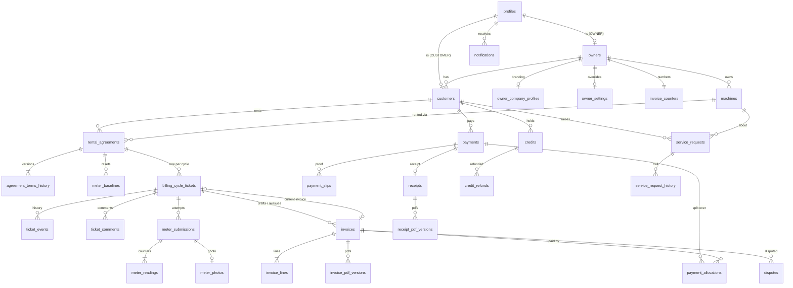

# RentDesk — Database

Supabase Postgres, one shared schema (`public`) for all tenants. Every tenant table has `owner_id`
and row-level security (RLS). Migrations live in `supabase/migrations/` (`0001`–`0033`). Types are
generated into `src/types/db.ts` with `npm run db:types`. The private `app` schema holds RLS helpers
and workflow functions. It is **not** exposed through the Data API.

## Conventions

- **Tenancy.** `owner_id → owners(id)` on every tenant table, plus composite foreign keys
  `(child_id, owner_id) → parent(id, owner_id)`. A row can never reference another tenant's row,
  even when written with the service role.
- **Identity.** `auth.users` holds credentials. The login email is synthetic:
  `{username}@users.rentdesk.invalid`. `profiles.id`, `owners.id` and `customers.id` are all the
  auth user id. Real contact emails live in `owners` and `customers`.
- **Money** is `bigint` cents. **Timestamps** are `timestamptz`. Deadlines are computed in
  `Asia/Colombo` by server code and passed in.
- **Errors** raised by the workflow functions use these SQLSTATE codes:
  - `RD400`: invalid input
  - `RD403`: actor not allowed
  - `RD404`: not found
  - `RD409`: stale state or conflict

## Tables

| Area | Table | Purpose |
| --- | --- | --- |
| Accounts | `profiles` | Role (`ADMIN`/`OWNER`/`CUSTOMER`), tenant, status, `must_change_password`, login security |
| | `owners` | Tenant business details, plan |
| | `owner_company_profiles` | Branding (spec 17): company, logo, bank details, letterhead + layout, payment instructions, `onboarding_completed_at`. Server-write-only since 0022 |
| | `customers` | Customer details (status lives in `profiles`) |
| | `subscription_plans` | Optional plans (ADM-07) |
| Settings | `platform_settings` | Global defaults (single row): stage deadlines, reminders, grace period, late fee, login lockout and session timeout |
| | `owner_settings` | Per-owner overrides (null = inherit); view `owner_settings_effective` merges them |
| Fleet | `machines` | Brand, model, serial, `MONO`/`COLOUR`, status, counter maximum (rollover) |
| | `rental_agreements` | Current terms, installation, initial/closing readings, `first_billing_date`, cycle calendar (`next_cycle_no/date`), `billing_day` (the first billing date's day of the month; cycles are monthly), late fee setting, return idempotency key |
| | `agreement_terms_history` | Every version of the pricing terms (commitment, included copies, rates, due days, late fee setting), who changed it, when, and the cycle it applies from. Append-only |
| | `meter_baselines` | New baseline after a meter reset or replacement: value, the reading it replaced (`previous_value`), the old meter's last reading and the copies carried into the next bill (`carried_copies`, decision 51). Written only by `record_meter_baseline` |
| Billing cycle | `billing_cycle_tickets` | One per agreement per cycle (unique `(agreement_id, cycle_no)`); terms snapshot; stage clock (`stage_entered_at`, `stage_due_at`, `reminder_count`, `escalation_level`, `paused_at`) |
| | `ticket_events` | Every transition: actor, from, to, reason |
| | `ticket_comments` | Ticket messages between the customer and the owner (TKT-11): author and role, body (≤ 1,000), `edited_at`, idempotency key; audited on insert and update (decision 50) |
| | `meter_submissions` | Each reading attempt (idempotency key, server timestamp, review outcome) |
| | `meter_readings` | Per-counter previous/current values, kept permanently |
| | `meter_photos` | Temporary photo record of a submission, or of a dispute (`dispute_id`: the fresh meter photo, decision 55); the file is deleted on confirm or when the dispute ends, the row stays |
| | `invoices` / `invoice_lines` | Draft → issued invoice; number assigned on issue; branding snapshot; PDF state (`pdf_status`, `pdf_revision`, `pdf_path`, attempts, last error); a corrected invoice points at the cancelled one it replaces (`replaces_invoice_id`, `revision`, decision 49) |
| | `invoice_pdf_versions` | Every PDF made for an invoice (`v1`, `v2`, …): reason, template, content hash, size, the customer and machine printed on v1. Append-only |
| | `invoice_counters` | Per-owner, gap-free invoice sequence |
| Payments | `payments` | Money received: a customer slip or an owner-recorded payment (cash, cheque, transfer, advance, security deposit). Status `SUBMITTED` → `ACCEPTED` / `PARTIAL` / `REJECTED`, later `REVERSED`; accepted amount, credit made, duplicate flag and reasons (`FILE`, `REFERENCE`) |
| | `payment_allocations` | How a payment is split over invoices (decision 39): planned at submission, applied when accepted, the balance left right after; `waiting` while the slip waits (one per ticket); released rows are the history of a reallocation |
| | `payment_slips` | File path (`{owner}/{customer}/{id}.{jpg,png,pdf}`), SHA-256 of the stored file and of the file as chosen (`original_sha256`), MIME type, size, retention date |
| | `receipts` / `receipt_counters` / `receipt_pdf_versions` | One receipt per accepted payment, numbered per owner without gaps (`RCT-000001`); content snapshot (payment, bills paid, balance after, credit, customer's outstanding), branding snapshot, PDF state; status `ISSUED` / `REVERSED`. PDF versions are append-only |
| | `credit_refunds` | Credits paid back to the customer (amount, date, method, reference). Append-only |
| | `disputes` | Invoice disputes, one per invoice (decision 47): reason, optional file (`attachment_*`, bucket `dispute-files`), the answer (`resolution_kind` REJECTED / CORRECTED / CREDIT / CANCELLED, `resolution`, `credit_id`, `replacement_invoice_id`, `new_due_date`), the fresh meter photo request (`photo_requested_at`, note, `photo_received_at`, `photo_readings`) |
| | `credits` | Overpayments, credits from cancelled invoices, advances (with agreement, date received, method, reference; or the payment that made them, `source_payment_id`). CREDIT invoice lines point at the credit they use (`invoice_lines.credit_id`). `refunded_cents`; status `VOID` when the payment that made it is reversed |
| | `deposit_transactions` | Security deposit ledger per agreement: received, deducted (paid an invoice), refunded, retained. Append-only, never below zero |
| Service | `service_requests` | Service requests (spec 7): machine, type, toner colours, part, description, urgency, preferred date, photo (`photo_*`, bucket `service-photos`), technician and planned visit, work done, parts, the owner's own cost (`cost_cents`, not readable by clients), the charge for the next bill (`charge_*`, decision 59), reopen count, rating, escalation level and time, idempotency key |
| | `service_request_history` | The status trail: every status change (trigger, with the function's note and metadata) and the other steps (`kind`: NOTE, ASSIGNMENT, ESCALATION, RATING, CHARGE) |
| Cross-cutting | `notifications` | The in-app centre (Realtime): one row per recipient, `read_at`; `owner_id` null for platform alerts to admins (daily job, decision 53) |
| | `notification_deliveries` | Email / SMS / WhatsApp outbox and delivery log (0032, decision 65): one row per notification and channel, written in the business transaction; recipient, category (ESSENTIAL / UPDATE / REMINDER), status (PENDING → SENT / FAILED / SKIPPED), attempts, next attempt, claim lease, provider id, the subject and address actually used. `notification_id` null for a direct send (login details) |
| | `notification_events` | Delivery catalogue (decision 66): which events have an email (category) and SMS; mirrors `src/lib/notifications/events.ts` |
| | `outbox_lease` | One row: which sender may drain the outbox now (0033). Server-only |
| | `notification_preferences` | Per user: reminder emails and update emails on/off (decision 68). Essential emails ignore it |
| | `notification_templates` | Email templates (decision 71): global (`owner_id` null, the admin's edits) and per-owner overrides; built-in defaults live in code. Written only through `rpc_save_notification_template` / `rpc_reset_notification_template` (0032) |
| | `idempotency_keys` | Request de-duplication for server actions |
| | `login_attempts` | Rate limiting / lockout input |
| | `audit_logs` | Append-only audit trail, written by triggers and `app.write_audit()` |
| | `cron_runs` | One row per run of the daily job: trigger, the "now" used (simulated outside production), status, counts, errors, work remaining |
| Views | `customer_balances` | Outstanding amount per customer: issued, unpaid invoices minus `amount_paid_cents` (security invoker, so RLS applies). Credits are not netted: they are shown apart and come off the next invoices (decision 45) |
| | `agreement_deposit_balances` | Deposit received / deducted / refunded / retained / held per agreement (security invoker) |
| | `notification_log` | The delivery log (NOT-05): in-app rows and their deliveries, one row per notification and channel (security invoker: both tables' RLS applies) |

## Who can do what

The database enforces this table. RLS policies use only four helpers in the private `app` schema:
`current_user_role()`, `current_owner_id()`, `current_customer_id()` and `is_admin()`. They are
`SECURITY DEFINER`, `STABLE`, and use `search_path = ''`. They return NULL unless the caller is
`ACTIVE` and, for a customer, their owner is `ACTIVE` too. Suspended or deactivated users, and
customers of a suspended owner, therefore match no policy and see nothing.

| Data | ADMIN | OWNER (own tenant) | CUSTOMER (own records) | anon |
| --- | --- | --- | --- | --- |
| profiles, customers | read all | read; update customer contact columns | read self | — |
| owners | read all | read self | read own owner | — |
| company profile / branding | read all | read (writes through `rpc_save_company_profile` / `rpc_save_invoice_template`) | read (own owner) | — |
| settings | read all; update global | read, insert, update own | — | — |
| machines | read all | read, insert, update details (not status, not type) | read those they rent | — |
| agreements | read all | read | read their own | — |
| agreement terms history | read all | read | — | — |
| customer balances (view) | read all | read | read own | — |
| meter baselines | read all | read (writes through `rpc_record_meter_baseline`) | — | — |
| tickets, events, comments, submissions, readings | read all | read (comments through `rpc_add_ticket_comment`) | read own (comments the same way) | — |
| meter photos (rows and files) | rows only | read | — | — |
| invoices, lines | read all | read | read own, **not DRAFT/REJECTED** | — |
| invoice PDF versions (rows and files) | read all | read | read own issued invoices | — |
| payments, allocations, slips, disputes, credits, refunds, receipts (+ PDF versions) | read all | read | read own | — |
| receipt counters | read all | read own | — | — |
| deposit transactions, deposit balances (view) | read all | read | read own | — |
| service requests + history | read all | read (not `cost_cents`: server only) | read own (not `cost_cents`) | — |
| notifications | read all | read tenant delivery log | read own; set `read_at` on own in-app rows | — |
| notification deliveries, `notification_log` | read all | read own tenant | — (own in-app rows only, through the view) | — |
| notification preferences | read own | read own | read own | — |
| notification events (catalogue) | read | read | read | — |
| templates | read all (writes through `rpc_save_notification_template`) | read global + own (same) | — | — |
| audit logs | read all | read own tenant | — | — |
| cron runs | read all | — | — | — |
| login_attempts, idempotency_keys | — | — | — | — |

**Server-write-only.** Clients have no write grants on these tables. Writes come only from server code
using the service role:

- `profiles`, `owners`, inserts into `customers`
- `rental_agreements`, `agreement_terms_history` and `machines.status` (migration 0014)
- tickets, events and comments
- meter baselines (since 0027)
- meter submissions, readings and photos
- invoices, invoice lines, invoice counters and invoice PDF versions (append-only)
- the company profile (`owner_company_profiles`, since 0022)
- payments, allocations, payment slips, receipts and their counters and PDF versions, disputes, credits and credit refunds
- deposit transactions (append-only even for the service role)
- service requests and their history (owners and customers act through the `rpc_*` functions, 0031)
- inserts into `notifications`; `notification_deliveries`, `notification_preferences` and `notification_templates` (0032)
- `idempotency_keys`, `login_attempts`, `audit_logs` and `cron_runs`

Customers write only through server actions. Clients have no DELETE grants (owners lost theirs on
notification templates in 0032). `audit_logs` is append-only even for the service role.

### Atomic workflow functions (`app` schema, called through `public.rpc_*`)

Server code (`src/lib/tickets`) validates the request and the actor's role. It then calls the
matching `public.rpc_<name>` wrapper with the service-role client, for example
`admin.rpc("rpc_confirm_meter_submission", …)`. Each wrapper only forwards to `app.<name>`.

- **Wrappers:** only `service_role` can execute them. Anon and authenticated get `42501`.
- **Default privileges:** in `public` they are revoked, so a new function is never callable by anon
  or authenticated unless granted explicitly.

Each function:

1. locks the ticket with `SELECT … FOR UPDATE`,
2. re-checks the current status and the actor,
3. writes every affected table in one transaction.

A concurrent second request waits for the lock and then fails with `RD409`.

| Function | Effect |
| --- | --- |
| `open_billing_cycle` | Creates ticket + event + notifications at the job's `p_now`; snapshots terms, late fee and the real days of the cycle; advances the monthly calendar; flags an earlier ticket still waiting for its reading as Overdue (11.6, owner notified); replays safely |
| `submit_meter_reading` | Submission + readings + photo row + draft invoice/lines → `PENDING_OWNER_REVIEW` (idempotent). Closes the older meter-stage tickets of the cycles it bills ("Billed in the cycle N invoice", rule 25); refused (`PREVIOUS_REVIEW_PENDING`) while an older reading waits for review, and a customer reading after the rejection limit (`TOO_MANY_REJECTIONS`, rule 28) |
| `confirm_meter_submission` | Assigns the invoice number, issues the invoice, marks the photo for deletion → `AWAITING_PAYMENT`. `p_submission_id` null = the ticket's estimated draft. Returns `photo_paths` and `photo_ids`: server code deletes the files at once and marks the rows |
| `correct_meter_reading` | INV-08 (rule 29): owner only, reading waiting for review, note required. The engine's recalculated draft is checked (`verify_meter_invoice`, `verify_invoice_credits`, same removed credits); the customer's value is kept in `corrected_from_value`; lines and totals replaced; `CORRECTION` event, audit `METER_READING_CORRECTED`, customer notified |
| `reject_meter_submission` | Reason required; draft → `REJECTED`; → `METER_REQUESTED`. `p_submission_id` null = reject the estimated draft (no second estimate for that ticket) |
| `submit_payment` | The customer's slip for one or more of their bills (decisions 39-41): locks every ticket then invoice in id order, checks each is payable (`assert_payable`), splits the amount oldest due first (`plan_allocation`; bills it does not reach are left out), flags duplicates (`payment_duplicates`), writes payment + slip + allocations, each ticket and invoice → `PAYMENT_SUBMITTED` with its event. Idempotent (key). Audit `PAYMENT_SUBMITTED` |
| `verify_payment` | Accept (the slip amount, or less if less arrived) → `apply_payment`: split again, each bill through `settle_invoice_payment` (paid → `CLOSED`, part → `PARTIALLY_PAID`, nothing → back to waiting), what is left over becomes an `OVERPAYMENT` credit, payment `ACCEPTED` or `PARTIAL`, receipt issued. Reject (reason) → every bill back to `AWAITING_PAYMENT` / `PARTIALLY_PAID`. Audit `PAYMENT_ACCEPTED` / `PAYMENT_REJECTED` |
| `record_manual_payment` | PAY-07: owner only, same split, accepted at once (each ticket: `PAYMENT_SUBMITTED` then `CLOSED` / `PARTIALLY_PAID`); no bills = an `ADVANCE` credit. Idempotent. Audit `PAYMENT_RECORDED` |
| `reverse_payment` | TKT-10 / 11.5 (decision 43): reason required; not for `SECURITY_DEPOSIT` payments; refused while its credit is used (also by a draft) or refunded, or a bill has a slip waiting, is disputed or cancelled. Each bill owes the money again (`CLOSED` → `REOPENED` → `AWAITING_PAYMENT`), credits → `VOID`, receipt `REVERSED` (new PDF). Audit `PAYMENT_REVERSED` |
| `reallocate_payment` | 11.5: reason required; same blocks; moves an accepted payment to other bills of the customer (split again, credit recalculated), old allocations released, same receipt number with new content (new PDF). Audit `PAYMENT_REALLOCATED` |
| `refund_credit` | PAY-12: owner only; refunds only what is free (amount − refunded − used, drafts reserve); `credit_refunds` row, `refunded_cents`, status `REFUNDED` when all of it is paid back. Audit `CREDIT_REFUNDED` |
| `settle_invoice_payment` | Internal (decision 42): sets what is paid on an invoice and walks its ticket through the allowed transitions, one event each; the invoice status follows |
| `claim_receipt_pdf`, `record_receipt_pdf`, `mark_receipt_pdf_failed`, `cron_pending_receipt_pdfs`, `cron_orphan_slips` | Receipt PDFs (like invoice PDFs) and the daily purge of slip files never sent |
| `transition_ticket` | Cancel (reason; supersedes a pending reading, ends an open dispute), reopen (reason), back to payment, clear an overdue payment (reason + `p_due_date`); the invoice follows. Disputes use their own functions |
| `raise_dispute` | Customer disputes an issued, unpaid invoice once (decision 47): reason, optional checked file in their folder, idempotency key → `DISPUTED`; refused with a slip waiting or a second time (`ALREADY_DISPUTED`). Audit `DISPUTE_RAISED` |
| `reject_dispute` | Owner: explanation, optional new due date (today or later) → `AWAITING_PAYMENT` (invoice partially paid if part was paid). Audit `DISPUTE_REJECTED` |
| `credit_dispute` | Owner: the engine's CREDIT line (`creditOnIssuedInvoice`) for a new credit of kind `DISPUTE`, up to what is left to pay (decision 48); the rest stays a credit; covered bills close (`close_if_settled`). Audit `DISPUTE_CREDIT_GIVEN` |
| `request_dispute_photo` / `submit_dispute_photo` | The fresh meter photo (decision 55): the owner asks (note), the customer sends a live photo in the ticket's folder with the reading(s); a `meter_photos` row of the dispute, deleted when the dispute ends (trigger on `disputes`) |
| `correct_issued_invoice` | Decision 49: owner, reason, new due date; refused with a slip waiting (`SLIP_WAITING`), on a closed ticket (`REOPEN_FIRST`) and for a reading that is no longer the latest (`LATER_READING`). Cancels the invoice (number voided, money paid → `CANCELLED_INVOICE` credit), checks the engine's corrected invoice against the original (`verify_corrected_invoice`) and the credits, issues it with a new number (`replaces_invoice_id`, revision + 1), replaces a corrected reading (old submission `SUPERSEDED`, a confirmed owner reading with `corrected_from_value`), resolves an open dispute as CORRECTED, moves the ticket to `AWAITING_PAYMENT` (closes it when credits cover it). Event `CORRECTION`, audit `INVOICE_CORRECTED` |
| `record_meter_baseline` | Decision 51: owner, live agreement, reason, per counter the new value and optionally the old meter's last reading (not below the last known reading); refused while a reading or estimate waits for review (`REVIEW_PENDING`). Event `BASELINE` on the newest open ticket, audit `METER_BASELINE_RECORDED` |
| `raise_service_request` | Decision 58: customer, a machine they rent now, type, toner colours (mono = black, colour = at least one), description, urgency, preferred date (today to a year), optional checked photo in their folder; idempotency key checked under an advisory lock (an overlapping retry returns the first request); 10 per customer per hour. Audit `SERVICE_REQUEST_RAISED`; the owner's notification in the same transaction |
| `service_request_action` | Decision 57: every step after raising (ACKNOWLEDGE, ASSIGN, START, RESOLVE, CLOSE by the owner; CONFIRM, REOPEN by the customer; CANCEL by either; NOTE) under the request lock: role, tenant and `service_transition_allowed`; RESOLVE records work, parts and cost and optionally the charge (refused once the agreement ended, `AGREEMENT_ENDED`) and a breakdown discount (a `SERVICE_DISCOUNT` credit); CANCEL drops a charge not yet billed and is refused while it is on a bill (`CHARGE_BILLED`). Trail row, audit `SERVICE_REQUEST_<ACTION>`, notifications |
| `rate_service_request` | SRV-09: the request's customer, once, only when Closed, 1-5 and a comment (≤ 500). Audit `SERVICE_REQUEST_RATED` |
| `escalate_service_request`, `cron_service_candidates`, `cron_orphan_service_photos` | Decision 61: compare-and-set escalation of a request still New (level 1 owner, 2 admin; skipped when acknowledged or already there), the daily job's candidates with the owner's settings (active accounts only), unsent photos older than 2 days |
| `service_charges_free`, `check_invoice_service_charges` | Decision 59: an agreement's charges not on a live invoice; the deferred constraint trigger on `invoices` that checks, at commit, that a new normal invoice lists exactly those (a recalculated draft keeps its own, a corrected one carries the replaced bill's), each with its ADJUSTMENT line, none on two bills, none on an estimate |
| `add_ticket_comment` / `edit_ticket_comment` | Decision 50: the ticket's customer or owner; 1-1,000 characters; idempotent; 30 per author per ticket per hour (`TOO_MANY_COMMENTS`); edits by the author within 5 minutes (`EDIT_WINDOW_OVER`), audited old → new |
| `resend_invoice_notification` | Spec 11.4: owner sends an issued invoice's notice again; `NOTE` event (`INVOICE_RESENT`), audit; not twice within 10 minutes |
| `carried_copies`, `verify_carried_copies`, `expected_estimate_credits`, `verify_estimate_credits` | Facts the meter and final invoice checks compare with the engine's calculation: copies carried from replaced meters (0027), estimated invoices to credit (0028) |
| `enqueue_notifications` | Writes the in-app rows and (0032) for catalogue events the email delivery, plus SMS / WhatsApp when switched on, in the caller's transaction: recipient address, category, PENDING or SKIPPED (`NO_EMAIL`, `OPTED_OUT`). An item may say `"email": false` |
| `claim_deliveries` / `record_delivery_result` / `email_quota` | The sender (decision 67): quota per UTC day and month (Resend sends only); claim due deliveries (emails up to the allowance, essential first, `FOR UPDATE SKIP LOCKED`, 2-minute lease and claim token; expires old reminders; with `p_essential_only` defers the rest to the next UTC day); record SENT / RETRY (FAILED after the last attempt) / FAILED / SKIPPED / POSTPONE, refusing a stale token; a failure alerts the owner (customer emails) or the admins (`alert_delivery_failed`). `delivery_context` gives the sender the message, recipient, branding, effective template and PDF to attach |
| `outbox_begin` / `outbox_end` | The sender's cheap "anything due?" check and its single lease (0033) |
| `mark_delivery_bounced` / `log_direct_delivery` | The Resend webhook's bounce, failure or complaint (once; alert); the login-details email, logged after it was sent without the password (decision 70) |
| `save_notification_template` / `reset_notification_template` | Admin: global text; owner: own override (RD403 otherwise); only email events of the catalogue; audited by the table trigger |
| `save_notification_preferences` / `set_admin_email` | The user's own email switches; the admin's alert address on `profiles.email` |
| `notify_contact_changed` (trigger) | A new email on `customers` / `owners` queues the test message to the new address (spec 11.8, decision 75) |
| `notify_admins_once`, `cron_last_success`, `cron_orphan_dispute_files` | Daily job: platform alerts to the admins once per key, the last finished run (missed-run alert after 30 hours), dispute files never sent |
| `create_estimated_invoice` | Daily job (rule 22): after the meter deadline, when the owner bills estimates, a draft estimated invoice from the engine (`verify_estimated_invoice`, credits checked) → `PENDING_OWNER_REVIEW`; once per ticket |
| `mark_ticket_overdue`, `record_ticket_reminder`, `escalate_ticket`, `apply_late_fee`, `set_ticket_pause` | Daily job steps (rules 20-24). Compare-and-set under the ticket lock: a step already done returns `{skipped}`. `apply_late_fee` re-checks the amount (ticket snapshot → owner → platform), the grace period, once only, never with a slip waiting or a dispute |
| `cron_begin_run` / `cron_finish_run`, `cron_context`, `cron_due_agreements`, `cron_ticket_candidates`, `cron_pause_candidates`, `cron_expired_photos`, `mark_photos_deleted`, `cron_orphan_photos`, `cron_overdue_summaries`, `notify_once` | The daily job's run record (10-minute lease), its reads (keyset pages) and the photo / weekly-summary steps |
| `assign_invoice_number` | Per-owner counter row lock. Rolls back with the transaction, so numbering is gap-free |
| `provision_account` | Profile + owner/customer rows; enforces Admin → Owner → Customer |
| `write_audit` | Explicit audit entries (logins, resets) |
| `login_gate_state` | Lock state, recent failures for the username and for the IP, and the thresholds, in one call |
| `record_login_attempt` | Records an attempt under a profile row lock. A wrong password counts; at the threshold `locked_until` is set (audit `LOCKOUT`). Success clears the lock and sets `last_login_at` (audit `LOGIN`). Failures write `LOGIN_FAILED` |
| `session_state` | Role, status, owner status, `must_change_password`, onboarding and session timeouts for the route guard |
| `set_account_status` | Admin → owner, owner → own customer only. Reason required (stored in the audit entry). The user is notified (in-app and email); since 0032 an owner's change is also told to that owner's active customers (decision 75) |
| `reset_account_password` | Same parent rule. Sets `must_change_password`, clears the lockout, audit `PASSWORD_RESET`. Call it **before** setting the new password through the Auth Admin API: it is the permission check |
| `complete_password_change` | Clears `must_change_password` (audit `PASSWORD_CHANGED`) |
| `update_owner` / `update_customer` | Account details with the same parent rule |
| `save_company_profile` | Owner only. Upserts branding; the first save sets `onboarding_completed_at` (BRD-01) |
| `assign_machine` | Owner of both the machine and the customer (another tenant's customer is "not found"). Machine `AVAILABLE`, customer `ACTIVE`, first billing date ≥ today (passed in) and after the start date, colour terms only for colour machines, whole non-negative readings. Creates the agreement (terms version 1 by trigger), machine → `RENTED`, `next_cycle_no = 1`, `next_cycle_date = first_billing_date`, audit `MACHINE_ASSIGNED`, customer notified |
| `return_machine` | Reason and closing reading(s) required; lower than the last known reading only on a counter with a maximum (rollover). `RD409 RETURN_BLOCKED:[…]` only while a meter reading waits for review (unpaid invoices do not block, RET-01). Issues the final invoice built by the billing engine (`app.final_cycle` facts, `app.verify_final_invoice`; closing readings stored as a confirmed owner reading), cancels open meter requests billed in it, settles the deposit or keeps holding it, agreement → `TERMINATED`, machine → `AVAILABLE`, audit `MACHINE_RETURNED`. Replays a retried request (`return_idempotency_key`) |
| `reassign_machine` | `return_machine` (same rules) + `assign_machine` in one transaction |
| `update_agreement_terms` | New terms version from the cycle after the one in progress (`app.cycle_in_progress + 1`); installation location and end date change at once; customer notified |
| `set_machine_status` | `AVAILABLE` / `UNDER_REPAIR` / `RETIRED` with a reason (audit). Never `RENTED`, never while rented |
| `settle_deposit` | Returned agreement only (settle later, DEP-04). Same rules as at return (`apply_deposit_settlement`): deduct + refund + retain = held; deductions pay the agreement's unpaid invoices (no slip waiting, not disputed) oldest due first as accepted payments of method `SECURITY_DEPOSIT`, closing paid tickets; refund needs date and method; retain needs a reason. Audit `DEPOSIT_SETTLED`, customer notified |
| `save_invoice_template` | BRD-04..07: letterhead path (the owner's own content-hash path), layout (preset, area inside the page, at least 50 % × 40 %), payment instructions (≤ 300). No letterhead clears the layout. Audited by the row trigger |
| `claim_invoice_pdf` / `record_invoice_pdf` / `mark_invoice_pdf_failed` / `cron_pending_invoice_pdfs` | Invoice PDFs (rule 34): claim a pending invoice for 5 minutes and get everything the PDF prints; record version n+1 (or "same as the newest"), READY only if `pdf_revision` did not move while rendering, audit `INVOICE_PDF_CREATED`; record a failure; the daily job's list (fewest attempts first) |
| `set_invoice_credit` | Rule 13: the owner removes a credit from a draft (or adds it back). Takes the engine's recalculation, checks only the customer-credit lines changed, swaps them; audit `INVOICE_CREDIT_REMOVED` / `RESTORED` |

Audit triggers record the actor:

- For a signed-in user, the actor is `auth.uid()`.
- For the service role, it is the `app.actor_id` set by these functions, or the `x-actor-id` request
  header. Both are honoured only when the JWT role is `service_role`.

> Keep `app` out of **Project Settings → Data API → Exposed schemas**. Only `public` and
> `graphql_public` are exposed. To make a new workflow function callable by server code, add a
> `public.rpc_*` wrapper and grant it to `service_role` only. `rls.db.test.ts` fails if any callable
> function in `public` is executable by anon or authenticated.

## Login security and sessions (migration 0013)

- **Lockout (AUTH-08).** Wrong passwords for a username are counted since the later of
  its last successful login and the start of the lockout window. After
  `login_max_failures` (5) the account is locked for `login_lockout_minutes` (15).
  Unknown usernames are treated the same way, so a lockout never reveals whether an
  account exists. One IP may fail `login_ip_max_failures` (30) times per
  `login_ip_window_minutes` (15). The pure decision is `src/lib/auth/login-gate.ts`.
- **Sessions (AUTH-09).** Supabase's own session limits are paid features, so the
  proxy (`src/proxy.ts`) signs users out after `session_idle_minutes` (30) without a
  request and `session_max_hours` (12) after signing in (from the JWT `amr` time).
- **Server Actions.** The proxy never redirects a Server Action request (POST with
  `Next-Action`): the browser would follow the 307 with the same POST and React throws
  "An unexpected response was received from the server". It signs the user out if
  needed, lets the request through and names the target page in the internal
  `x-rentdesk-redirect` request header (a client-sent copy is dropped). `currentActor()`
  then calls `redirect()` to it, so an expired, blocked or gated session lands on the
  right page (e.g. `/login?reason=idle`).
- **Blocked accounts (AUTH-10).** The proxy reads `session_state` on every page
  request and signs out suspended or deactivated users and customers of an inactive
  owner, with a message on `/login`. The RLS helpers already return nothing for them.
- **Audit (AUTH-11).** `LOGIN`, `LOGIN_FAILED`, `LOCKOUT`, `LOGOUT`, `PASSWORD_RESET`,
  `PASSWORD_CHANGED` and `STATUS_CHANGE` (with the reason) are written to `audit_logs`.
- All thresholds are columns of `platform_settings`; the admin may change them.

### Custom Access Token hook

`public.custom_access_token_hook(event jsonb)` runs inside Supabase Auth before any
token is issued, so the rules above also hold when someone calls Supabase Auth
directly with the public anon key (bypassing the app). It refuses a token with
`403 RD_BLOCKED:<REASON>` when:

- the user has no profile, is `SUSPENDED` or `DEACTIVATED`, or is a customer whose
  owner is not `ACTIVE` (password sign-in **and** token refresh);
- the account is locked (`locked_until` in the future), for password sign-in only, so
  someone else's wrong guesses cannot sign the real user out.

Only `supabase_auth_admin` may execute it. The app works the same with or without it;
the login page shows the same clear messages either way.

**Enable it (once per project):**

1. Open the Supabase dashboard for the project and go to **Authentication → Hooks**
   (under *Configuration*).
2. Click **Add a new hook** and choose **Customize Access Token (JWT) Claims hook**.
3. Hook type: **Postgres**. Schema: **public**. Function: **custom_access_token_hook**.
4. Make sure **Enable Customize Access Token (JWT) Claims hook** is switched on, then
   click **Create hook**.
5. Check: sign in as `owner.lanka` (works). As admin, suspend a test owner and try to
   sign in as that owner: the login page says the account is suspended.

To turn it off, disable or delete the hook on the same page; nothing else changes.

### Supabase Auth rate limits

Sign-ins go through the app's server, so Supabase Auth sees the server's IP for every
user. Before production, raise **Authentication → Rate Limits → Sign-ups and
sign-ins** well above the default (for example to a few hundred per 5 minutes); the
app's own per-account and per-IP limits above protect logins instead.

## Machines and agreements (migration 0014)

- **Cycle calendar (monthly since 0017).** Cycle *n* is due on `first_billing_date + (n − 1) months`, on the same
  day of the month (the last day of shorter months, then back to the original day: no drift). It covers the
  days from cycle *n − 1*'s date to the day before its own (cycle 1 never starts before `start_date`). The
  start date may be in the past (existing rentals being migrated); the first billing date must be today or
  later. `app.cycle_date`, `app.cycle_days`, `app.cycle_in_progress` and `app.final_cycle` mirror
  `src/lib/agreements/cycle-calendar.ts`. `billing_day` = the first billing date's day.
- **Terms changes (AGR-02).** The agreement row holds the terms in force. An edit writes a new
  `agreement_terms_history` version effective from the next cycle; `open_billing_cycle` snapshots the
  latest version effective for the cycle it opens (and copies it onto the agreement). Open tickets keep
  their snapshot. Tickets also snapshot `due_days`.
- **Guards (triggers).** A machine becomes `RENTED` only with a live agreement and leaves it only when the
  agreement ends; its type and tenant cannot change once rented. An agreement needs an `AVAILABLE`
  machine; customer, machine, start date, first billing date, cycle length and initial readings are fixed;
  a terminated agreement stays terminated. One live agreement per machine (partial unique index).

## Client decisions (migrations 0016–0017)

- **Payment method `SECURITY_DEPOSIT`** ("From security deposit") for invoices paid from a deposit; `DEPOSIT`
  stays a cash deposit at the bank. Own migration (0016): a new enum value is usable only once committed.
- **Credits (rule 13).** `app.available_credits(customer, exclude_invoice)`: credits with something left, oldest
  first; what is left = amount − CREDIT lines on live invoices (drafts reserve). Every new invoice must list
  exactly that set minus the credits the owner removed (`calculation.credits` / `credits_excluded`), or it is
  refused with `RD409` (recalculate); the customer's credit rows are locked while checking. A trigger keeps
  `credits.status` in step: `APPLIED` once issued invoices use all of it, `AVAILABLE` again if such an invoice
  is cancelled.
- **Late fee (LATE-01).** `late_fee_mode` (`OWNER_DEFAULT` / `CUSTOM` / `NONE`) + `late_fee_cents` on the
  agreement, every terms version and every ticket. The amount in force is resolved in TypeScript
  (`resolveLateFee`) and charged by the daily job (`app.apply_late_fee`, 0019).
- **Deposits.** `deposit_transactions` (RLS: owner own tenant, customer own, admin all; clients read only;
  service role select + insert, no update/delete). A trigger refuses an entry for another customer than the
  agreement's, or one that would take the balance below zero. Upfront money is recorded by `assign_machine`
  (`p_terms.upfront`): `SECURITY_DEPOSIT` → `RECEIVED` entry, `ADVANCE_PAYMENT` → `credits` row of kind `ADVANCE`.
- **Service-role reads.** New tables get no automatic grants in this project; 0017 grants the service role
  `select` on `agreement_terms_history` (the return loader reads the terms in force) and on the deposit tables.

## Tickets and the daily job (migrations 0018–0019)

- **Event types** `PAUSED`, `RESUMED`, `LATE_FEE` (0018, its own migration: a new enum value is usable only once committed).
- **Stage clock.** `stage_entered_at` is set whenever the status changes (`app.enter_stage`, or `app.enter_stage_at` with
  the job's time). Reminders and escalation count from it; `reminder_count` / `escalation_level` reset with each stage.
- **Daily job** (`src/lib/cron/daily.ts`, `/api/cron/daily`): pause/resume → open due cycles (catch-up) → ticket sweep
  (overdue, estimate, reminders, admin escalation, late fee) → meter photo purge → weekly overdue summaries. Pure
  decisions in `src/lib/cron/decide.ts`. All database access goes through the `rpc_*` wrappers, so `cron.db.test.ts`
  runs the same code with `pg` inside the test transaction and a simulated clock.
- **Idempotency.** Each write is a compare-and-set under the ticket lock (expected status, `reminder_count`,
  `escalation_level`, `late_fee_cents = 0`, one estimate per ticket); `open_billing_cycle` replays. `cron_begin_run`
  takes an advisory lock and gives a running run a 10-minute lease.
- **Notifications** are built by `src/lib/notifications/service.ts` (in-app rows today; email is added there).
- **Time override** (non-production only): `x-rentdesk-now` header or `?now=` on `/api/cron/daily`
  (`npm run cron:run -- --now=2026-11-01T01:00:00+05:30`). Production builds ignore it (`src/lib/cron/time.ts`).

## Meter review (migrations 0020–0021)

- **Customer path.** The browser uploads the live photo to `meter-photos/{owner}/{ticket}/{photo id}.jpg` (storage policy:
  own ticket, waiting for a reading, not paused); the server action checks folder, size and JPEG signature, recalculates
  with the billing engine and calls `rpc_submit_meter_reading` with the idempotency key.
- **Owner path.** Review reads the photo through a 5-minute signed URL made with the owner's own client (storage RLS);
  confirm, reject, correct and manual entry go through `src/lib/tickets/transitions.ts`. `onInvoiceIssued`
  (`src/lib/invoices/issued.ts`) runs after an invoice is issued: the PDF and email plug in there (task 6b).
- **Grant (0021).** The service role reads `owner_settings_effective` (it was recreated in 0017 without the grant).
  `meter-review.db.test.ts` checks that the service role can read every table the meter service reads.

## Invoice PDFs and the letterhead (migrations 0022–0023)

- **Pending flag.** A `before insert or update` trigger on `invoices` (`app.invoice_pdf_flag`) sets `pdf_status = PENDING`,
  bumps `pdf_revision` and records the reason when an issued invoice is issued, gets a late fee, a new due date, new
  amounts or credits, or is cancelled. Payment status changes do not (no PAID stamp). Issuing updates the invoice twice in
  one transaction, so a PDF still waiting for its first version keeps the reason ISSUED (0023).
- **Rendering** (`src/lib/invoices/pdf-job.ts`): claim → build the document from the stored invoice, lines and
  `branding_snapshot` → skip if the content hash equals the newest version → render (pdf-lib, Noto Sans) → upload
  `v{n}.pdf` → record. Called after confirm and return (`onInvoiceIssued` / `onInvoiceChanged`), by the daily job for
  everything still pending, and by the seed. All through `rpc_*`, so `invoice-pdfs.db.test.ts` runs the real job.
- **Backfill.** 0022 marked every invoice issued before it as pending; the next daily job (or `npm run db:seed`) makes their PDFs.
  Dev-database invoices issued before 0015 have no stored `calculation`, so their PDFs have no readings table.
- **Writes.** Owners lost their direct insert/update grants on `owner_company_profiles` and the branding bucket's
  write policies: the server validates first (English only, rule 33; file checks, rule 36) and writes with the service role.

## Payments (migrations 0024–0025)

- **Enum values (0024)**, in their own migration: payment `REVERSED`, credit `VOID`, ticket event `PAYMENT` (a payment change that keeps the
  ticket's status).
- **Allocations.** `payments.invoice_id` / `ticket_id` are gone; every payment's bills are in `payment_allocations` (0025 backfilled one row
  per earlier payment and a receipt for every accepted one). Deposit settlements (`apply_deposit_settlement`, rewritten) write allocations
  and receipts too.
- **State machine.** One new edge, `PARTIALLY_PAID → AWAITING_PAYMENT` (the only payment on a partly paid bill is reversed), in
  `app.ticket_transition_allowed` and `src/lib/tickets/states.ts`. All payment status changes go through `app.settle_invoice_payment`.
- **Locks.** Payment functions lock the payment, then the tickets, then the invoices, each in id order (`lock_invoices_and_tickets`), the
  same order as the daily job, so concurrent payments never deadlock.
- **Receipts.** `app.issue_receipt` takes the next number from `receipt_counters` (row lock, rolled back with the transaction: gap-free) and
  stores `app.receipt_content` and `app.branding_snapshot`. A trigger marks the PDF pending on issue, reversal or a changed content.
- **Credits.** `app.available_credits`, `refresh_credit_status` and the TypeScript `loadAvailableCredits` subtract `refunded_cents`.
- **Grants.** New tables: `select` for authenticated (RLS decides) and service_role; writes only through the functions.

## Disputes, messages and the section 11 pass (migrations 0026–0029)

- **Enum value (0026)**, in its own migration: credit kind `DISPUTE`.
- **Settings.** `platform_settings.dispute_reminder_days` (`{3,5}`) and `dispute_escalation_days` (7), exposed by
  `owner_settings_effective` (decision 52). The view was replaced with the two columns appended (grants kept).
- **Disputes.** One per invoice (`raise_dispute` refuses a second); `resolution_kind` is set by every answer, and a
  trigger fills it (Cancelled / Rejected) and marks the dispute's fresh photo for deletion whenever a dispute ends,
  including when the ticket is cancelled. `meter_photos.submission_id` may be null when `dispute_id` is set (exactly one).
- **Corrections** cancel and reissue (decision 49); `invoices.revision` counts the versions of a bill.
- **Baselines** are written only by `record_meter_baseline`; owners lost their direct insert. The previous reading
  rule is unchanged (`last_known_reading`); `carried_copies` adds the old meter's copies to the next calculation.
- **Estimate reconciliation (0028).** `verify_meter_invoice` and `verify_final_invoice` now also check that the issued
  estimated invoices since the last confirmed reading are credited (`expected_estimate_credits`, the same query as the
  TypeScript loader).
- **Overlapping retries (0029).** `raise_dispute` and `add_ticket_comment` check the idempotency key under the ticket
  lock (as `submit_meter_reading` does): a retry sent while the first request is still running waits and returns the
  first result instead of failing. Tested with two connections on a committed fixture.
- **Grants.** Every new function is revoked from anon and authenticated; wrappers are service-role only
  (`rls.db.test.ts` lists them).
- **Tests.** `scenarios.db.test.ts`: disputes each way (reject, credit, covered bill closed, corrected bill), the fresh
  photo and its storage rule, correction after confirmation (closed and paid ticket, part payment, adjustment, later
  reading, estimate, tampering), baselines (carried copies, reset, refusals), estimate reconciliation, comments (RLS,
  edits, rate limit, audit), dispute files, resend, admin alerts, machine swap.

## Service requests (migrations 0030–0031)

- **Enum value (0030)**, in its own migration: credit kind `SERVICE_DISCOUNT` (decision 60).
- **Workflow.** `raise_service_request`, `service_request_action` and `rate_service_request` lock the request (an advisory lock on the key
  for raising) and write the request, the trail, the audit entry and the notifications in one transaction. The status trigger now
  records the function's actor, note and metadata (`app.status_note`, `app.status_meta`, transaction-local and reset after each change).
- **Charges on the next bill** (decision 59). No column on invoice lines: an invoice's `calculation.service_charges` lists the charges it
  bills (id, description, amount). A charge is "on a bill" while a live invoice (not rejected or cancelled) lists it; drafts reserve it.
  The check runs as a **deferred constraint trigger** (`invoices_service_charges`) because the lines are written after the invoice row:
  in a request it fires at commit. Tests that need it call `SET CONSTRAINTS ALL IMMEDIATE` (`service.db.test.ts`, `committed()`).
- **Discount** (decision 60): `credits.service_request_id` (unique) links the `SERVICE_DISCOUNT` credit to its request.
- **Owner's cost** (decision 64): `authenticated` has column grants on `service_requests` without `cost_cents` (and the idempotency key);
  `select *` by a client is therefore refused. The server reads the cost with the service role after RLS showed the row.
- **Grants.** New functions are revoked from anon and authenticated; the wrappers `rpc_raise_service_request`, `rpc_service_request_action`,
  `rpc_rate_service_request`, `rpc_escalate_service_request`, `rpc_cron_service_candidates`, `rpc_cron_orphan_service_photos` are
  service-role only (`rls.db.test.ts`).
- **Tests.** `service.db.test.ts`: raising (owner told at once, URGENT / HIGH titles, idempotent, toner colours, rented machine, photo folder),
  the full lifecycle with trail and audit, refusals by role and tenant, reopen, cancel rules, escalation by urgency through the daily job's
  own step (also suspended accounts and a missed day), the charge on the next reading (refused without it, held by a draft, freed by a
  rejection, on the final invoice, carried by a correction, refused after the return), the discount credit, rating rules, RLS on requests,
  the trail and photos, the hidden cost.

## Notifications and email (migration 0032)

- **Outbox (decision 65).** `app.enqueue_notifications` (every workflow function calls it) writes the in-app row and, for
  events in `notification_events`, a `notification_deliveries` row per channel in the same transaction. Nothing is sent
  from the database: server code (`src/lib/notifications/outbox.ts`) claims due rows after the request (`after()`) and in the
  daily job's last step, renders and sends them through Resend, and records the outcome. A rolled-back change has no row.
- **Sender lease (0033).** `outbox_begin(p_now)` first checks, read-only on the partial index `(next_attempt_at) where status = 'PENDING'`, whether anything is due, and returns null when not (no write); otherwise it takes the one-row `outbox_lease` (60 s on the database clock) and returns a token, or null when another sender holds it. `outbox_end(token)` gives it back; a crashed sender's lease runs out.
- **Claims.** `claim_deliveries` locks with `FOR UPDATE SKIP LOCKED` and gives the batch a claim token and a 2-minute lease;
  `record_delivery_result` accepts only the current token, so a sender that lost its lease cannot overwrite a newer result.
  Resend's `Idempotency-Key` is the delivery id.
- **Retries and limits (decisions 67, 69).** `next_attempt_at` carries the backoff (5 min, 20 min, 80 min, about 5 h),
  `email_max_attempts` (5) ends in FAILED. `email_quota` counts Resend sends per UTC day and month against
  `email_daily_limit` (100) and `email_monthly_limit` (3,000); inside `email_essential_reserve` (20) only ESSENTIAL rows are
  claimed and the rest move to the next UTC midnight; REMINDER rows older than `email_reminder_expiry_days` (3) are skipped.
- **Preferences (decision 68).** `notification_preferences` (no row = everything on); `delivery_opted_out` is checked when a
  row is queued, so a turned-off email is logged as SKIPPED.
- **Templates (decision 71).** Owners lost their direct insert/update/delete grants and policies; `save_notification_template`
  checks who may change which row. The variables are checked by the server before it calls it.
- **Read state.** Users still update only `read_at`, now only on their own **in-app** rows (policy re-created).
- **Realtime (0033, decision 76).** The bell uses **Broadcast**: statement-level triggers on `notifications` call
  `realtime.send` once per user and statement on the private topic `notifications:<user id>` (payload: only the kind of change);
  the policy "rentdesk: own bell signals" on `realtime.messages` lets only that active user join it. `notifications` was removed
  from the `supabase_realtime` publication, so Realtime no longer decodes the write-ahead log for it.
- **Grants.** New tables: `select` for authenticated (RLS decides) and select / insert / update for the service role (no
  delete: cleanups go through `SUPABASE_DB_URL`). New functions are revoked from anon and authenticated; their `rpc_*`
  wrappers are service-role only (`rls.db.test.ts`).
- **Tests.** `notifications.db.test.ts`: the catalogue equals the TypeScript one, rows written with the change and gone with a
  rollback (and invisible to another connection until commit), no address / opted out / in-app only, retries with backoff to
  FAILED and the owner's alert, a permanent error, the claim lease and stale tokens, the cap (essential only, deferral to the
  next UTC day, nothing at the limit, expiry), the sender lease (nothing due = null and no write, one holder, only the holder releases, a lost lease runs out) and the bell's Broadcast signals (one per user and statement, no content, the realtime.messages policy), templates (owner → global → built-in, who may change which, reset, no direct
  writes), the bill's PDF (wait, then attach), owner suspension told to customers, bounces and direct sends, RLS on
  deliveries, the log view and preferences. The sender runs with a fake transport: nothing is sent.

## Storage

All buckets are private. Files are served through short-lived signed URLs. Paths start with
`{owner_id}/`.

| Bucket | Limit / types | Direct client access |
| --- | --- | --- |
| `meter-photos` | 1 MB; JPEG, WebP | Customer uploads to `{owner}/{ticket}/{photo id}.jpg` while their ticket awaits a reading, or while their open dispute waits for a fresh photo (0027). Only the owner reads (signed URL). Deleted on confirm; rejected after retention; never-submitted after 2 days (rule 30) |
| `payment-slips` | 5 MB; JPEG, PNG, PDF | Customer uploads into `{owner}/{customer}/` (their own folder only, 0025). The server checks the stored file before recording it; the owner and admin read only recorded slips, the customer their folder. Files never sent with a payment are purged after 2 days |
| `receipts` | 10 MB; PDF | Server writes only. `{owner_id}/{receipt_id}/v{n}.pdf`: owner (own tenant), the payment's customer and admin read |
| `branding` | 5 MB; PNG, JPEG, SVG, PDF | Server writes only (0022). Owner, their customers and admin read. Logos at `{owner_id}/logos/{sha256}.png` (max 512 px, SVG rasterised on the server; older `{owner_id}/logo.png` still valid), letterheads at `{owner_id}/letterheads/{sha256}.{pdf,jpg,png}`. Never overwritten or deleted (rule 35) |
| `dispute-files` | 5 MB; JPEG, PNG, PDF | Customer uploads into `{owner}/{customer}/` (own folder). The server checks the stored file before recording it with the dispute; the owner and admin read only files sent with a dispute, the customer their folder. Unsent files purged after 2 days (0027) |
| `service-photos` | 5 MB; JPEG, PNG | Customer uploads into `{owner}/{customer}/` (own folder, 0031). The server checks the stored file before recording it with the request; the owner and admin read only photos sent with a request, the customer their folder. Unsent photos purged after 2 days |
| `invoices` | 10 MB; PDF | Server writes only. `{owner_id}/{invoice_id}/v{n}.pdf`: owner (own tenant), the invoice's customer (issued invoices only) and admin read. `{owner_id}/preview/sample.pdf`: the owner's sample preview |

## Tests and seed

- `npm run test:db` runs RLS and workflow tests against the linked dev database.
  - It uses `SUPABASE_DB_URL`. Use the **session pooler** URI: long runs over the direct IPv6 host
    dropped their connection.
  - Each suite builds a two-tenant fixture inside a transaction and rolls it back. The concurrency
    test needs two connections, so it commits a fixture and deletes it afterwards.
  - `DB_TEST_APPLY_MIGRATIONS=1` also applies not-yet-pushed migrations inside the test transaction
    first.
- `notifications.db.test.ts`: the email outbox and sender (see above).
- `payments.db.test.ts`: every payment flow, SQL split = TypeScript split, duplicates, receipts gap-free and under concurrency (committed
  fixture, skipped with `DB_TEST_APPLY_MIGRATIONS=1`), orphan slips, RLS on slips, allocations, receipts and refunds.
- `npm run db:seed` (`scripts/seed.ts`) creates demo accounts, machines, agreements and tickets in
  several stages through the same workflow functions. It is safe to re-run, and it prints the demo
  logins. A re-run also restores the demo login state (active, not locked, forced password change
  only for `cust.bandara`) and owner B (`owner.ceylon`) as not onboarded.
- The seed writes its agreements with the service role (stable ids, backdated first billing dates to create
  tickets in several stages); the same triggers apply as for `rpc_assign_machine`.
- `cron.db.test.ts` runs the daily job with simulated dates in 2024-2025, when no seed or fixture agreement is due.
- Feature e2e specs reuse one saved session per demo account (`signInCached`, `playwright/.auth/`, cleared by the global
  setup) to stay under Supabase Auth's sign-in rate limit; raise that limit before production (see above).
- `npm run test:e2e` runs on a production build (`next build` + `next start`, port 3100); `npm run test:e2e:dev`
  uses `next dev`. It signs in with the seed accounts. Its global setup and teardown restore them
  and delete the `owner.e2e-*` / `cust.e2e-*` accounts and the `E2E-*` machines (with their agreements) the
  tests create (needs `SUPABASE_DB_URL`).
